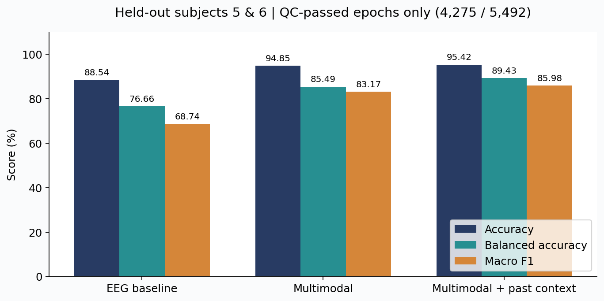
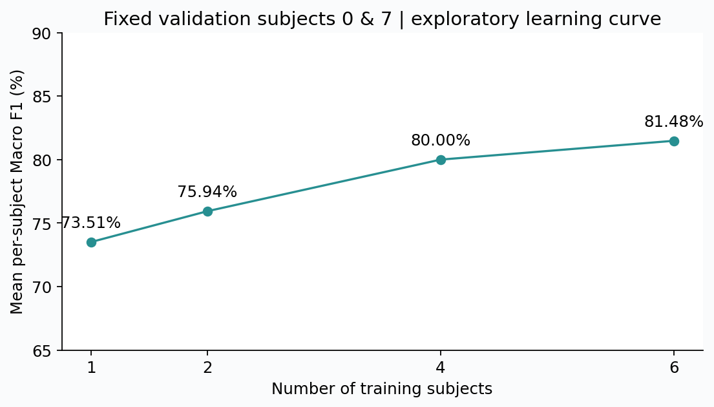
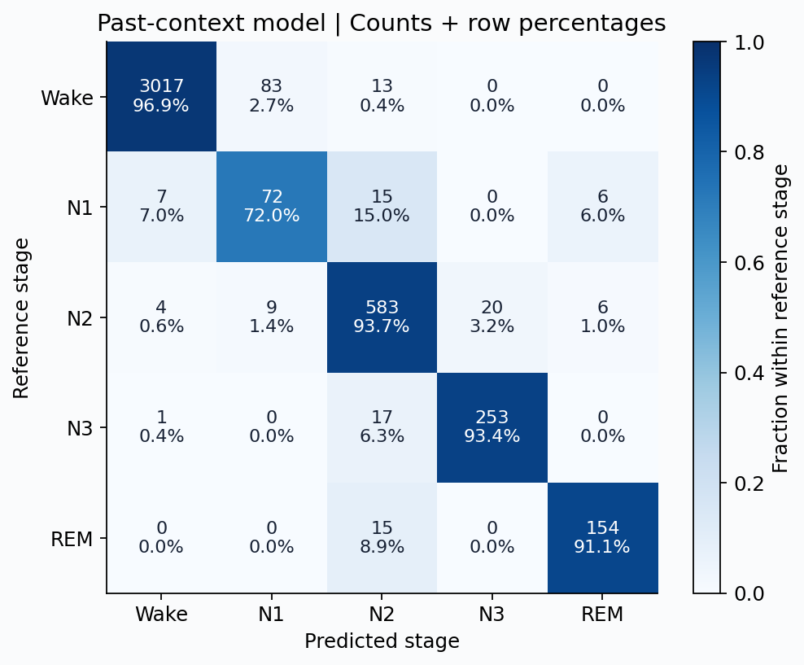
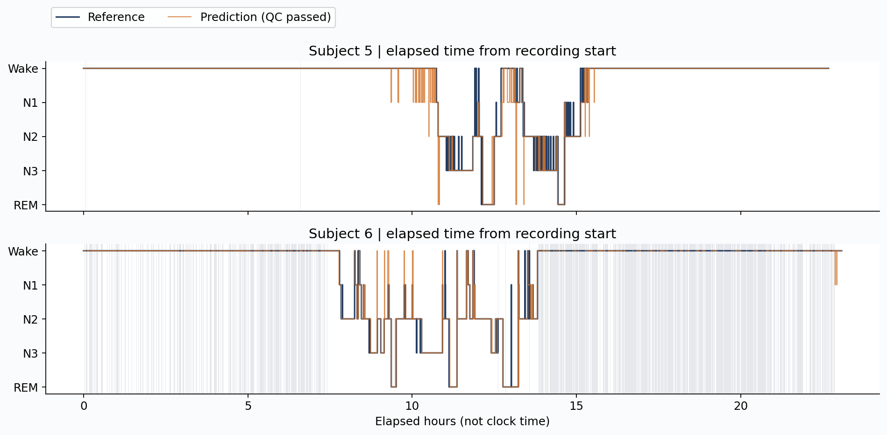
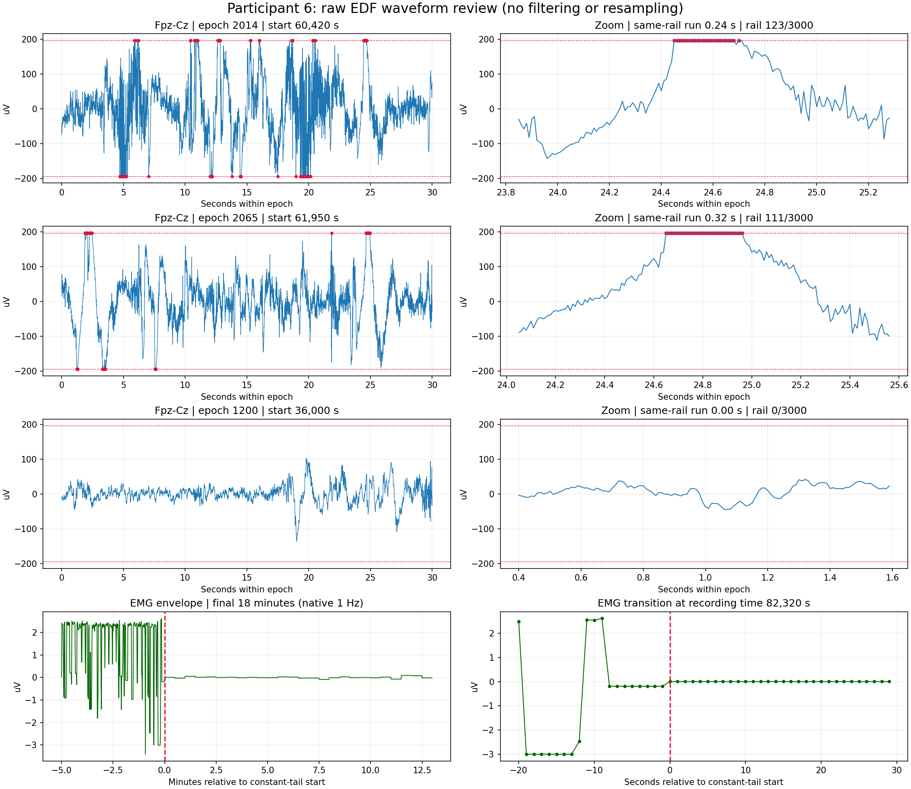
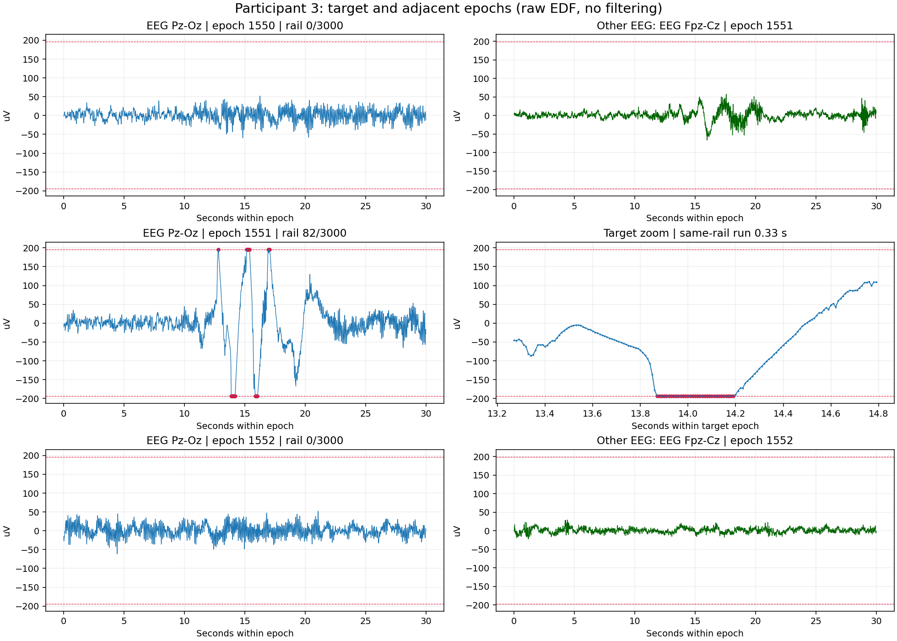
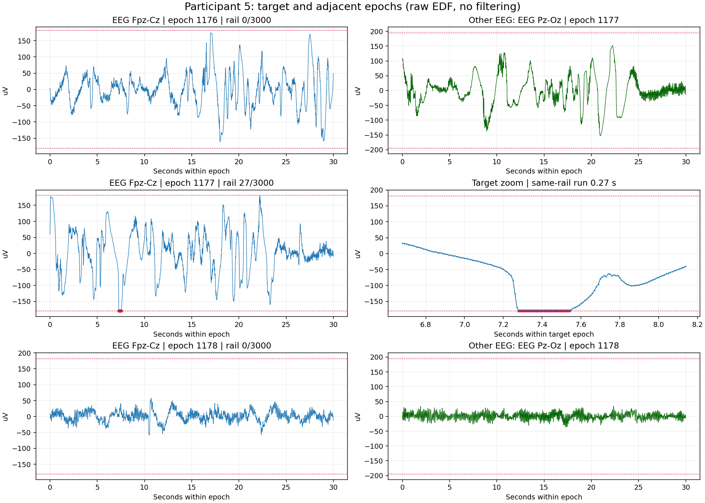

# Sleep AI — 수면 단계 분류와 신호 품질 검증

공개 수면 데이터를 이용해 **분류 모델을 만들고, 성능 수치가 놓치는 오류와 데이터 품질 문제를 추적한 연구 포트폴리오**입니다. 연구 범위는 10명 수면 단계 분류와 품질 감사, 대표 원본 파형 확인까지입니다.

> **현재 결과:** 평가 참가자 2명의 품질 통과 4,275구간에서 Accuracy 95.42%, Macro F1 85.98%. N1 정밀도는 43.90%이며, Wake→N1 진입 탐지는 기준 사건 20건 중 4건을 탐지했습니다. 높은 전체 정확도가 안정적인 수면 진입 감지를 뜻하지는 않습니다.

## 1. 목적과 진행 범위

장기적인 관심은 수면 상태 이해와 수면 조절입니다. 이번 작업은 그 전제인 **수면 단계 판별과 입력 신뢰성 검증**에 집중했습니다. 수면 유도 장치, 임상 진단, 실시간 개인 수면 서비스는 구현하지 않았습니다.

| 진행 항목 | 확인한 내용 |
|---|---|
| Apple Health 추출 | XML/ZIP을 읽어 수면·심박·HRV 요약을 만드는 코드 구현 |
| 공개 EEG 분류 | 참가자 단위 분할, 5개 단계 분류, 입력 및 시간 문맥 비교 |
| 오류 분석 | N1 오분류, Wake→N1 전환 평가의 경계 오류 수정 |
| 품질 감사 | 10명 전체 PSG의 30초 구간을 원래 샘플링 주기로 점검 |
| 원본 파형 확인 | 참가자 3·5·6의 EEG 한계값 접촉과 평탄 구간 확인 |

Apple Health 파서는 데이터 추출 도구입니다. EEG 모델과 연결되지 않았으며, Apple Core를 N1/N2로 재분할하는 기능은 없습니다. 개인 건강 기록 및 보고서는 이 저장소에 포함하지 않았습니다.

## 2. 실험 설계

- 데이터: PhysioNet Sleep-EDF Expanded v1.0.0, 참가자 0–9, 첫 번째 밤.
- 학습: 3, 2, 4, 9, 1, 8 / 검증: 0, 7 / 평가: 5, 6. seed 42.
- 구간: 30초. 분류: Wake / N1 / N2 / N3 / REM.
- 모델: Random Forest. EEG 기준 모델 → 다중 신호 → 과거 시간 문맥 비교.
- 시간 문맥: 현재 구간과 과거 최대 3구간의 평균 및 이전 구간과의 차이. 미래 구간은 사용하지 않고, 시간 공백·품질 불량에서는 문맥을 초기화합니다.
- 평가 구간: 전체 라벨 구간 5,492개 중 품질 통과 4,275개(77.84%). **제외 구간은 정확도 분모에 포함되지 않습니다.**

## 3. 실제 분류 결과

| 모델 | Accuracy | Balanced accuracy | Macro F1 | N1 recall |
|---|---:|---:|---:|---:|
| EEG 기준 | 88.54% | 76.66% | 68.74% | 28.00% |
| 다중 신호 | 94.85% | 85.49% | 83.17% | 58.00% |
| 다중 신호 + 과거 문맥 | 95.42% | 89.43% | 85.98% | 72.00% |

위 표는 평가 참가자 구간을 합친 지표입니다. 사람별 평균과는 다릅니다. 원자료는 [metrics.json](results/classification/metrics.json)에 보존했습니다. 이 결과는 기존 실행 결과이며, 포트폴리오 정리 과정에서 10명 모델을 다시 학습한 결과가 아닙니다.

학습 참가자 1→2→4→6명에 따라 고정된 검증 참가자 2명의 평균 Macro F1은 73.51→75.94→80.00→81.48%였습니다. 한 번의 작은 분할에서 관찰한 결과이며 일반화 성능이 보장된다는 뜻은 아닙니다.

실제 N1 100구간 중 72개를 맞혔지만, N1으로 예측한 164개 중 92개는 다른 단계였습니다. 그중 83개는 Wake였습니다. **N1 재현율 향상만으로 수면 진입을 안정적으로 알릴 수 있다고 결론 내릴 수 없습니다.**

회색 영역은 품질 검사로 제외된 구간입니다. 해당 구간을 연결해서 연속 예측처럼 표시하지 않았습니다.

## 4. QA 관점에서 확인한 문제

| 문제 | 확인 및 조치 | 남은 한계 |
|---|---|---|
| 전환 평가 경계 | 기준 N1 관측 전 경보가 매칭되던 사례를 제외하도록 수정 | 수정 후 20건 중 4건 매칭, recall 20% |
| 정확도와 커버리지 | 제외된 구간을 별도로 기록하고 평가 분모 명시 | 제외 구간에서 모델 성능은 알 수 없음 |
| 기존 진폭 기준의 사각지대 | EEG의 디지털 한계값 접촉을 별도 검사하고 원본 파형 확인 | 한계값 접촉만으로 자동 제외하는 기준은 미검증 |
| 1Hz EMG 해석 | EEG와 다른 원래 샘플링 주기로 감사 | 일정값 구간의 원인은 아직 확인하지 못함 |
| 파일 누락·재현성 | manifest 포함 패키지 수정, 체크섬·오프라인 모드·단위 테스트 | 다른 환경에서 완전히 같은 수치가 나오는지 미확인 |

전환 탐지: 12개 경보 중 4개 매칭(precision 33.33%), 기준 사건 20개 중 4개 매칭(recall 20%). 매칭된 4건의 지연은 모두 60초입니다. 이 정의는 임상적 수면 잠복기와 다릅니다.

### 품질 감사와 파형 확인

전체 PSG 27,476구간, 4개 채널 109,904행을 점검했습니다. 라벨에 맞춰 정렬한 학습 구간 27,464개와 분모가 다릅니다. 기존 제외 기준에 해당한 1,233구간은 모두 EOG의 peak-to-peak ≥1,000µV 조건이었습니다.

참가자 6에서 1,215구간이 제외되어 문제가 특정 기록에 집중됨을 확인했습니다. 대표 파형을 확인했으며, 비교 구간에 한계값 접촉이 없다는 이유만으로 정상 신호로 판정하지 않았습니다.

참가자 6 — EEG clipping 의심 파형과 EMG 말미 확인

Fpz-Cz epoch 2014: 한계값 123/3,000 samples, 최대 연속 0.24초. Epoch 2065: 111/3,000, 최대 0.32초. 마지막 13분의 EMG는 각 30초 구간 안에서 일정하지만 구간 사이 값은 달라집니다. 센서 고장으로 단정하지 않았습니다.

참가자 3·5 — 다른 기록에서도 확인한 한계값 접촉

참가자 3 epoch 1551: Pz-Cz 82/3,000 samples, 최대 연속 0.33초.

참가자 5 epoch 1177: Fpz-Cz 27/3,000 samples, 최대 연속 0.27초. 다른 EEG 채널도 변동이 크므로 자동 대체가 안전하다고 보지 않았습니다.

## 5. 배운 점과 다음 과제

1. 전체 정확도와 특정 단계의 검출 능력은 분리해서 평가해야 합니다.
2. 품질 검사로 제외하는 비율도 성능과 함께 보고해야 합니다.
3. 숫자 기반 품질 지표는 원본 파형과 대조해야 합니다.
4. 평가 데이터에서 문제를 본 뒤 기준을 바꾸면 새 독립 평가가 필요합니다. 참가자 5·6은 이후 진단에 사용했으므로 새 개선의 최종 검증 대상으로 재사용하지 않습니다.
5. Apple Watch 입력과 EEG 입력은 다릅니다. 개인 기록 연결과 N1/N2 추정은 별도 연구 과제입니다.

채널별 품질 기준 변경, 입력 조합 재학습, 개인 수면 상태 추정은 **이번 포트폴리오 범위 이후의 미완료 작업**입니다.

## 6. 코드와 재현 방법

- [실행 방법](docs/REPRODUCING.md): 기존 결과 확인, 그래프 재생성, 예측 재평가, 선택적 재학습.
- [결과 출처와 버전](docs/PROVENANCE.md): v0.3 분류 결과와 v0.4 전환 수정, v0.5.0 감사 구분.
- [데이터 출처·이용 조건](docs/DATA_AND_ATTRIBUTION.md).
- `analyze.py`: Apple Health 추출 / `eeg/`: 분류·전환·품질 감사 / `tests/`: 기존 검증 코드.

이 프로젝트는 AI 도움으로 코드·문서를 작성하고, 사용자가 로컬에서 데이터 실행과 결과 확인을 진행한 개인 연구입니다. 합성 테스트의 통과는 실제 EEG 성능 검증과 별개입니다.
